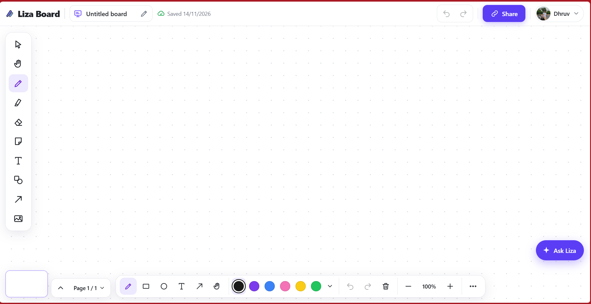

# Whiteboard

A touch whiteboard web app for phones, tablets, laptops and smartboards that reads
your writing and turns it into answers, worked steps, live graphs, 3D models, a
geometry lab and simulations. It is self-contained: `backend/` holds its own copy of
the reading and answering code (first taken from Liza's Transcribe Board), `public/`
its own pages, and `.env` its own keys. It does not use or call Liza in any way.

## What it does

**The board (Liza Board):** a top bar with the board's name, its save state, undo/redo, Share and
your profile; tools down the left (Select, Pan, Pen, Marker, Eraser, Sticky, Text, Shapes,
Connector, Image); everyday tools, six colours and zoom along the bottom; pages bottom left; and
the **Ask Liza** panel on the right with Create a mind map, Explain a concept and Generate a flowchart.
Signed-in people's boards are saved to their account (`boards.py`); **Share** copies a link that
gives whoever opens it their own copy. There is no live drawing together on one board.


- **She reads it.** About 1 s after you stop writing: "I read: 2x + 3 = 7".
- **Pick part of the board** with Select: tap a drawing, Shift-tap to add more, drag a box round
  several, or Ctrl+A; right-click or tap blank space to let go. The picked drawings glow, and she reads, offers buttons for and answers
  about only those (Ask Liza on the selection bar). Nothing picked: the whole page in view again.
- **A graph drawn without its equation** gets "See the graph" with the reader's guess (y = x²).
- **One action dock** under "I read: …", always at the top of the board: her buttons for this writing
  (Plot it, See it in 3D, Run the simulation, Solve it…), then Explain, Picture and Diagram (not for
  maths), Questions, Summarise and Neaten writing for any topic.
- **Neaten writing** (dock, or the selection bar): the handwriting read and swapped for typed text in
  its place, one undo step (`/api/neaten`). A drawing in the selection: she asks for just the writing.
- **Questions and Summarise** (dock, or the panel's starters): six questions, easy to hard, with hidden
  answers, or a short summary of the page, pitched at the **Level** in the panel (Class 1-12, College,
  Higher studies), and either can go on the board as a note (`/api/study`).
- **Board style** (… menu): dots, lines, boxes or plain, on white, cream, mint, sky, lilac, a green
  chalkboard or night; on the dark two, black ink is drawn chalk white.
- **The panel's back arrow** returns to the starters from a conversation or a chosen starter.
- **Check my work** (dock for maths, or the panel): each line of the working marked ✓/✗ with what is
  wrong, a nudge and one thing done well, never the answer (`/api/check`).
- **Syllabus and Language** next to Level: CBSE/NCERT, ICSE, state board, IB, IGCSE; summaries,
  questions and marking in English or 11 Indian languages.
- **Teacher outputs:** a printable question paper with marks and an answer key, every page as a PDF
  (… menu), and **Record a lesson** (the board and your voice as a video).
- **Classroom mode** (`classroom.py`, `public/classroom.js`, the **Class** button): the admin makes
  someone a teacher; a teacher starts a class and gets a 6-letter code or link; students join and
  their boards show as live pictures on the teacher's screen; the teacher sends a question to every
  student and can show their own board to the class. Polling every 4 s, no sockets.
- **Share** opens Copy link, Google Classroom, Microsoft Teams and WhatsApp.
- **Running it as a service:** a daily AI limit per person (`WB_DAILY_AI`, `WB_DAILY_AI_TEACHER`;
  admins have none; today's count on the admin page), a daily database copy kept 14 days
  (`backups.py`, in `data/backups/`), a privacy page, and **Delete my account** in the profile menu.
- **Installable** (`manifest.webmanifest`, `sw.js`): add it to the home screen; it opens and draws
  without internet (Liza needs it).
- **Her buttons under the writing:** Solve it, Plot it, Balance it, See the reaction,
  See it in 3D, See the shape, Measure it (drawn figures tidied, corners lettered,
  angles written in, the total shown), and Explore it.
- **Ask her anything about the board.** Type it, say it (mic), or tap **Ask Liza**.
  Examples: "Is my answer right?", "What did I draw?", "Find the missing side", "इसे हल करो".
  She answers out loud in her voice. Her worked steps appear beside your writing,
  each one lit as she says it, with her **See the graph / 3D / shape** button at the end.
- **Her graph card** has a slider for every number or letter. **Her geometry lab** lets you
  turn solids and tap corners, edges and faces to measure. **Her 3D models** include
  molecules and the engine's simulations.
- **Her 3D Explorer** (50 models: black hole, Milky Way, planets, organs, spacecraft…):
  a **Visualize in 3D** button comes up whenever the writing or a question names one.
- **Her engine's 63 models in real 3D**, including all 29 simulations (projectile motion,
  pendulum, orbits, lenses, waves…), molecules and organs. They're stored in `public/scene3d/` and played by `public/engine3d.js`: drag to turn all the way
  round, pinch to zoom, sharp at the screen's own resolution, with her readouts and sliders.
  Her web copy plays these as flat 800×360 videos instead.
- **Her worked steps are typeset** (KaTeX, in `public/vendor/katex`) instead of her
  338-pixel picture of them, so they're sharp on any screen.
- **Class** (under **…**) sets how deep her answers go, as a student's class does on the device.

## Run it

One-time setup:

```bash
python3 -m venv .venv && .venv/bin/pip install -r requirements.txt
```

Then:

```bash
./serve.sh            # port 8095
```

Open the address it prints on any device on the same network. On a phone, use
**Add to Home Screen** for full screen. To put it on the internet, see
`tools/deploy_aws.sh` (Docker + Caddy HTTPS on one server).

- Keys live in `.env` (never commit it): `OPENROUTER_API_KEY` for reading and answers,
  `CARTESIA_*` for the voice (the browser's voice is used without it), `GROQ_*` for the mic.
- The mic needs a secure page: `http://localhost:8095` or https, not plain `http://192.168…`.
- `WB_CLASS` in the environment sets the default class (8).

## Layout

- `access.py`: Google sign-in, admins, the activity log. `boards.py`: saved boards, share links, mind maps and flowcharts.
- `server.py`: FastAPI. `/api/board/read`, `/api/turn`, `/api/visual`, `/api/graph`,
  `/api/geometry*`, `/api/transcribe`, `/api/tts`. It serves `public/`.
- `backend/`: the board's brains (`board`, `brain`, `geolab`, `model3d`, `voice`, and
  `backend/liza/` for the reading, solutions, graphs and geometry).
- `public/app.js`, `public/core.js`: the board itself (pens, shapes, eraser, undo, zoom, files).
- `public/liza.js`: the reading chip, buttons, asking, steps, graph card and full-screen views.
- `public/live.js`: live graph key points, solid size sliders, the projectile simulation.
- `public/lw/`: the page modules, the 3D Explorer and recordings (`js`, `holo`, `media3d` link into it).
- `public/scene3d/`: captured 3D scenes and `index.json`.

## Tests

```bash
node test/core.test.js                                       # the board's logic
node --experimental-websocket test/browser.mjs [shots]       # the board by touch, stylus, mouse
node --experimental-websocket test/liza.mjs [shots]          # every Liza flow, model scripted (no cost)
node test/live.test.mjs                                      # graph, geometry and projectile maths
```

`test/fake_server.py` is the server with only the model scripted. The browser
tests open the page from `file://`, because headless Chromium has no network inside
the Claude Code sandbox, and route `/api` calls to the server through DevTools.


