# Whiteboard vs Liza: side by side

Same finger-written board, same question. Liza: her device reader and buttons, and her
answer through her web copy. Whiteboard: its own server and endpoints.

## linear

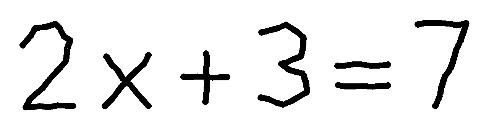

**Question:** Solve what I've written on the board, step by step.

| | Liza | Whiteboard |
|---|---|---|
| Read | 2x + 3 = 7  | 2x + 3 = 7  |
| Buttons | Solve it (ask: solve) Plot it (graph: 2x + 3 = 7) | Solve it (ask: solve) Plot it (graph: 2x + 3 = 7) |
| Measured | – | – |
| Said | Okay, let's solve this together. First, we need to get the '2x' by itself, so we'll take 3 from both sides of the equation. That leaves us with 2x equals 4. Then, to find out what 'x' is, we divide both sides by 2. So, x is 2! | Okay, let's solve this. First, we need to get the 2x by itself, so we take 3 from both sides of the equation. That leaves us with 2x = 4. Then, to find what x is, we divide both sides by 2. So, x equals 2! |
| Shown | show_visual:solution / Solve 2x + 3 = 7; 2x + 3 = 7 :: the equation; 2x = 7 - 3 = 4 :: take 3 from both sides; x = \frac{4}{2} = 2 :: divide both sides by 2; answer = x = 2; see = graph: y = 2x + 3 | steps column (4 rows), see: See the graph buttons: See the graph |

## quadratic

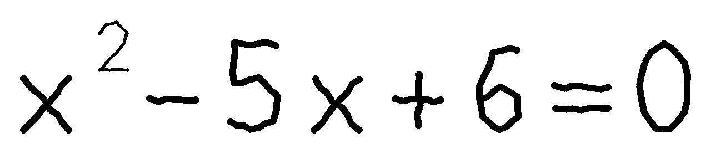

**Question:** Solve this

| | Liza | Whiteboard |
|---|---|---|
| Read | x² − 5x + 6 = 0  | x² − 5x + 6 = 0  |
| Buttons | Solve it (ask: solve) Plot it (graph: x² − 5x + 6 = 0) | Solve it (ask: solve) Plot it (graph: x² − 5x + 6 = 0) |
| Measured | – | – |
| Said | Okay, let's solve this quadratic equation. First, we need to factor the expression x^2 - 5x + 6. We're looking for two numbers that multiply to 6 and add up to -5, which are -2 and -3. So, we can write it as (x - 2)(x - 3) = 0. This means either x - 2 is 0 or x - 3 is 0. If x - 2 = 0, then x is 2. And if x - 3 = 0, then x is 3. So the solutions are x equals 2 and x equals 3. | Let's solve this quadratic equation. First, we can factor the expression x^2 - 5x + 6 into two parts. We need two numbers that multiply to 6 and add up to -5, which are -2 and -3. So, we can write it as (x - 2)(x - 3) = 0. This means either x - 2 is 0 or x - 3 is 0. If x - 2 = 0, then x is 2. If x - 3 = 0, then x is 3. So, the solutions are x equals 2 and x equals 3. |
| Shown | show_visual:solution / Solve x^2 - 5x + 6 = 0; x^2 - 5x + 6 = 0 :: the equation; (x - 2)(x - 3) = 0 :: factor the quadratic; x - 2 = 0 \text{ or } x - 3 = 0 :: set each factor to zero; x = 2 \text{ or | steps column (5 rows), see: See the graph buttons: See the graph |

## function

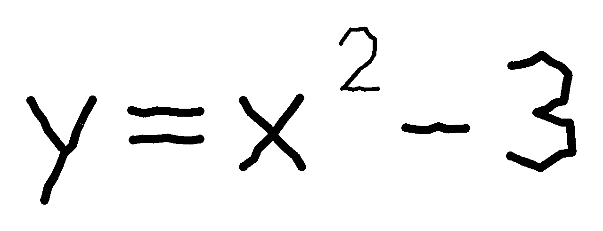

**Question:** Look at what I've written on the board and help me with it.

| | Liza | Whiteboard |
|---|---|---|
| Read | y = x² − 3  | y = x² - 3  |
| Buttons | Plot it (graph: y = x² − 3) | Plot it (graph: y = x² - 3) |
| Measured | – | – |
| Said | You've written the equation for a parabola, which is a U-shaped curve. This specific one opens upwards and crosses the y-axis at -3. Let me show you what it looks like. | This is an equation for a parabola, which is a U-shaped curve. The x^2 part makes it that shape, and the -3 means the whole curve is shifted down by three units on the graph. Here it is. |
| Shown | show_visual:graph / y = x^2 - 3 | visual graph: y = x^2 - 3 |

## two-functions

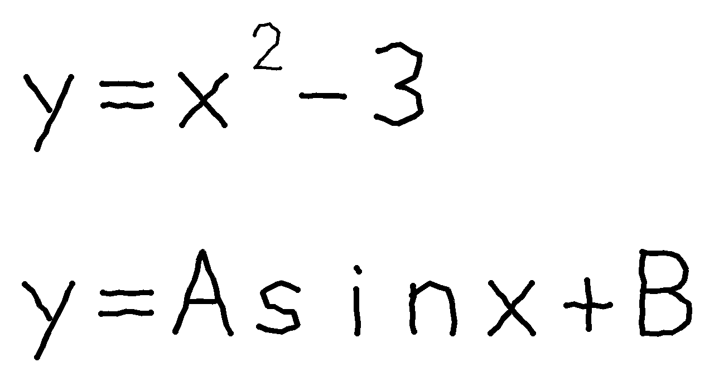

**Question:** Look at what I've written on the board and help me with it.

| | Liza | Whiteboard |
|---|---|---|
| Read | y = x² − 3 ; y = A sin x + B  | y = x² − 3 ; y = A sin x + B  |
| Buttons | Plot them (graph: y = x² − 3; y = A sin x + B) | Plot them (graph: y = x² − 3; y = A sin x + B) |
| Measured | – | – |
| Said | The first equation, y = x^2 - 3, will draw a U-shaped curve called a parabola. The second one, y = A sin x + B, will create a wave shape. Let me put them both on a graph for you, and you can drag the 'A' and 'B' sliders to see how they change the wave. | Oh, these are great! The first one, y = x^2 - 3, makes a U-shaped curve called a parabola. The second one, y = A sin x + B, creates a wave-like curve. I can put them both on a graph for you, and you'll be able to play with the 'A' and 'B' values to see how they change the wave. |
| Shown | show_visual:graph / y = x^2 - 3; y = A sin x + B; A=1; B=0 | visual graph: y = x^2 - 3 and y = A sin x + B, A=1, B=0 |

## circle-equation

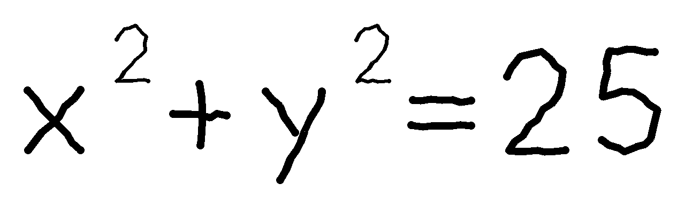

**Question:** What does this graph look like?

| | Liza | Whiteboard |
|---|---|---|
| Read | x² + y² = 25  | x² + y² = 25  |
| Buttons | Plot it (graph: x² + y² = 25) See the shape (shape: Circle; radius = 5) | Plot it (graph: x² + y² = 25) See the shape (shape: Circle; radius = 5) |
| Measured | – | – |
| Said | That equation, x squared plus y squared equals twenty-five, describes a circle. It's a circle centered right at the origin, which is the point where the x and y axes cross, and it has a radius of five units. Here, let me put it up for you. | That equation, x squared plus y squared equals twenty-five, describes a circle. It's a round shape where every point on the edge is the same distance from the center. In this case, the center of the circle is right at the origin, which is the point (0,0) on a graph, and its radius, which is the distance from the center to any point on the circle, is 5 units. Here, I'll show you what it looks like. |
| Shown | show_visual:graph / x^2 + y^2 = 25 | visual graph: x^2 + y^2 = 25 |

## fractions

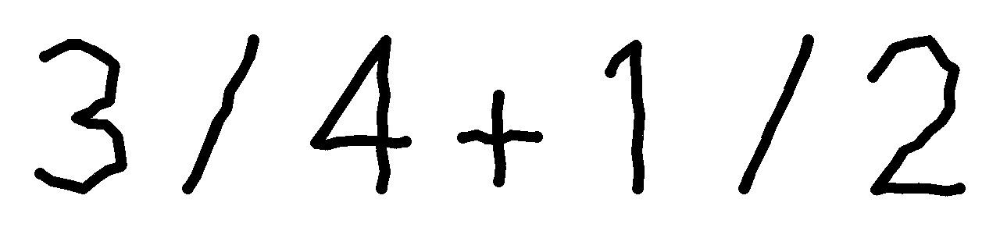

**Question:** Solve this

| | Liza | Whiteboard |
|---|---|---|
| Read | 3/4 + 1/2  | 3/4 + 1/2  |
| Buttons | Solve it (ask: solve) | Solve it (ask: solve) |
| Measured | – | – |
| Said | To add these fractions, we first need to find a common denominator. The denominators are 4 and 2, and the smallest number they both divide into is 4. So, we'll convert one-half into an equivalent fraction with a denominator of 4. That means one-half becomes two-fourths. Now we have three-fourths plus two-fourths. We add the numerators, 3 plus 2, which gives us 5. So the answer is five-fourths, or one and one-fourth. | Okay, let's add these fractions. First, we need to make sure both fractions have the same bottom number, which is called the denominator. The smallest common denominator for 4 and 2 is 4. So, we'll change one-half into an equivalent fraction with a denominator of 4. One-half is the same as two-fourths. Now we can add three-fourths and two-fourths together. That gives us five-fourths. Since the top number is bigger than the bottom number, we can write it as a mixed number: one whole and one-fourth. |
| Shown | show_visual:solution / Add fractions; \frac{3}{4} + \frac{1}{2} :: the sum; \frac{3}{4} + \frac{2}{4} :: convert \frac{1}{2} to \frac{2}{4} to get a common denominator; \frac{3+2}{4} :: add the numera | steps column (6 rows) |

## reaction

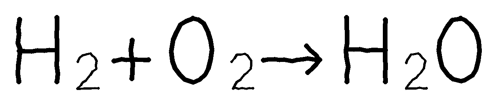

**Question:** Can you balance this?

| | Liza | Whiteboard |
|---|---|---|
| Read | H₂ + O₂ → H₂O  | H₂ + O₂ → H₂O  |
| Buttons | Balance it (ask: balance) See the reaction (reaction: H2 + O2 -> H2O) | Balance it (ask: balance) See the reaction (reaction: H2 + O2 -> H2O) |
| Measured | – | – |
| Said | Okay, let's balance this reaction step by step. First, we have two oxygen atoms on the left and only one on the right, so we'll put a '2' in front of the H2O. Now we have four hydrogen atoms on the right, but only two on the left, so we'll put a '2' in front of the H2. That balances it! | Of course! Let's balance this reaction. First, we have two oxygen atoms on the left and only one on the right, so we'll put a 2 in front of the water molecule. Now we have four hydrogen atoms on the right, so we need to put a 2 in front of the hydrogen molecule on the left. That balances it out! |
| Shown | show_visual:solution / Balance H2 + O2 -> H2O; H2 + O2 -> H2O :: the original equation; H2 + O2 -> 2H2O :: 2 oxygen on the left, 1 on the right, so put 2 in front of H2O; 2H2 + O2 -> 2H2O :: now 4 hyd | steps column (4 rows), see: See the reaction buttons: See the reaction |

## molecule

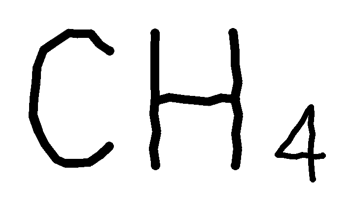

**Question:** What is this?

| | Liza | Whiteboard |
|---|---|---|
| Read | CH₄  | CH₄  |
| Buttons | See it in 3D (model3d: CH4) | See it in 3D (model3d: methane) |
| Measured | – | – |
| Said | That's the chemical formula for methane. Methane is a simple gas that's the main part of natural gas, which we use as fuel. Its formula, CH4, tells us that each molecule of methane has one carbon atom and four hydrogen atoms bonded together. | That's methane, a chemical compound made of one carbon atom and four hydrogen atoms. A chemical compound is a substance formed when two or more different chemical elements are chemically bonded together. Methane is a simple molecule, which is the smallest unit of a compound, and it's the main component of natural gas, often used as a fuel. |
| Shown | offer_visual:model3d / Methane; C | buttons: See it in 3D |

## cube

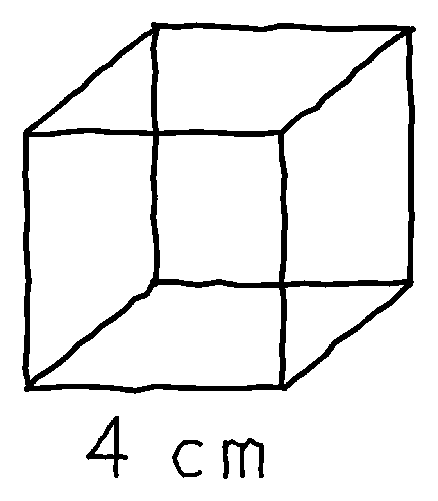

**Question:** What is its volume?

| | Liza | Whiteboard |
|---|---|---|
| Read | a cube with 4 cm written below it  | a cube with 4 cm written below it  |
| Buttons | See it in 3D (model3d: Cube; side = 4 cm) See the shape (shape: Cube; side = 4 cm) | See it in 3D (model3d: Cube; side = 4 cm) See the shape (shape: Cube; side = 4 cm) |
| Measured | – | – |
| Said | To find the volume of a cube, you multiply the length of one side by itself three times. So, for a side of 4 cm, you'd calculate 4 times 4 times 4. That gives you 64 cubic centimeters. | To find the volume of a cube, we multiply its side length by itself three times. So, for your cube with a side of 4 cm, we'll calculate 4 times 4 times 4. That gives us 64 cubic centimeters. |
| Shown | show_visual:solution / Volume of a cube; V = s^3 :: the formula for volume; V = 4^3 :: substitute the side length; V = 4 \times 4 \times 4 = 64\ \mathrm{cm^3} :: calculate the product; answer = 64 cm^ | steps column (4 rows), see: See it in 3D buttons: See it in 3D |

## cylinder

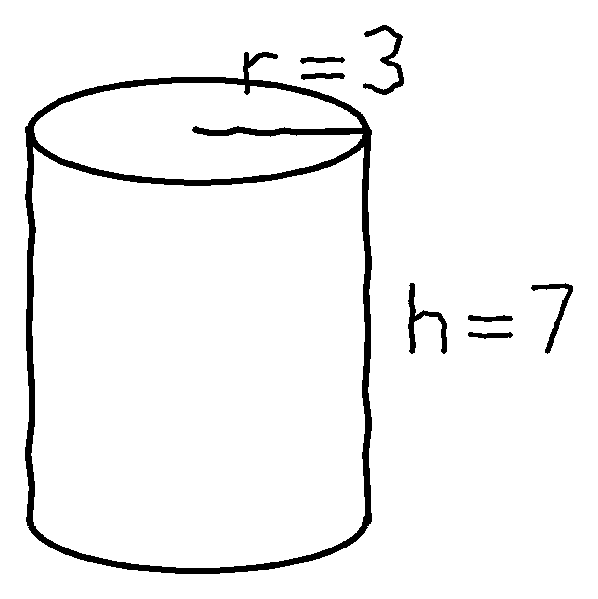

**Question:** Find the volume

| | Liza | Whiteboard |
|---|---|---|
| Read | a cylinder with radius r = 3 and height h = 7  | a cylinder with radius r = 3 and height h = 7  |
| Buttons | See it in 3D (model3d: Cylinder; radius = 3; height = 7) See the shape (shape: Cylinder; radius = 3; height = 7) | Solve it (ask: solve) See it in 3D (model3d: Cylinder; radius = 3; height = 7) See the shape (shape: Cylinder; radius = 3; height = 7) |
| Measured | – | – |
| Said | Okay, you've drawn a cylinder with a radius of 3 and a height of 7. To find the volume of a cylinder, you multiply the area of its circular base by its height. The area of a circle is π times the radius squared. So, you'll have π times 3 squared, multiplied by 7. That gives you 9π times 7, which is 63π. If you want to see the steps written out, just let me know! | To find the volume of a cylinder, we use the formula V = πr²h. First, we'll square the radius, which is 3, so 3 squared is 9. Then, we multiply that by the height, which is 7, and by pi. So, 9 times 7 is 63, giving us 63π. |
| Shown | – | steps column (5 rows), see: See the shape buttons: See the shape |

## right-triangle

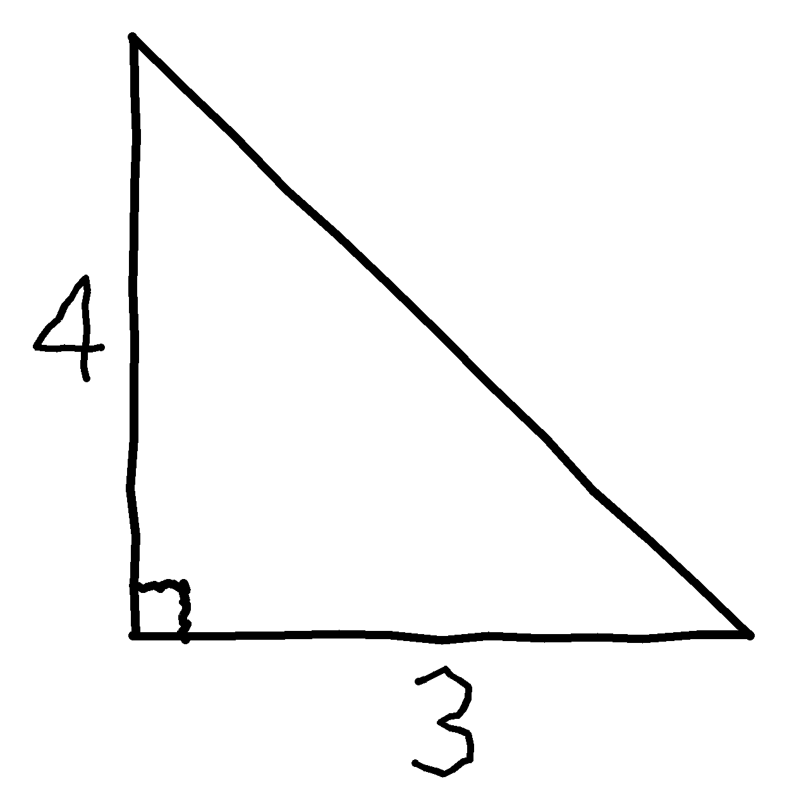

**Question:** Find the missing side

| | Liza | Whiteboard |
|---|---|---|
| Read | a right triangle with sides 3 and 4  | a right triangle with sides 3 and 4  |
| Buttons | Solve it (ask: solve) Measure it (measure: Right triangle; side 1 = 4; side 2 = 3) Explore it (explore: Right triangle; side 1 = 4; side 2 = 3) | Solve it (ask: solve) See the shape (shape: Right triangle; side = 3; side = 4) |
| Measured | {'angles': [[63, 101, 232, 101, 266, 93, 44], [89, 96, 82, 93]], 'faces': 2} | – |
| Said | Okay, I see you've drawn a right-angled triangle with sides 3 and 4. To find the missing side, which is the hypotenuse, we use the Pythagorean theorem. It says that in a right triangle, the square of the hypotenuse (the longest side) is equal to the sum of the squares of the other two sides. So, we'll square 3 and 4, add them together, and then find the square root of that sum. First, we write down the Pythagorean theorem. Then, we substitute the known side lengths, 3 and 4, into the formula. Next, we calculate the squares of 3 and 4. Now, we add those two numbers together. To find the missing side, we take the square root of 25. So, the missing side is 5. | This is a right-angled triangle, so we can use the Pythagorean theorem. First, we square the two sides you know, 3 and 4. Then we add those squares together, and finally, we take the square root of that sum to find the missing side. It's 5! |
| Shown | show_visual:solution / Find the missing side of the right triangle; a^2 + b^2 = c^2 :: This is the Pythagorean theorem, which helps us find the missing side in a right-angled triangle; 3^2 + 4^2 = c^2 | steps column (6 rows), see: See the shape buttons: See the shape |

## triangle

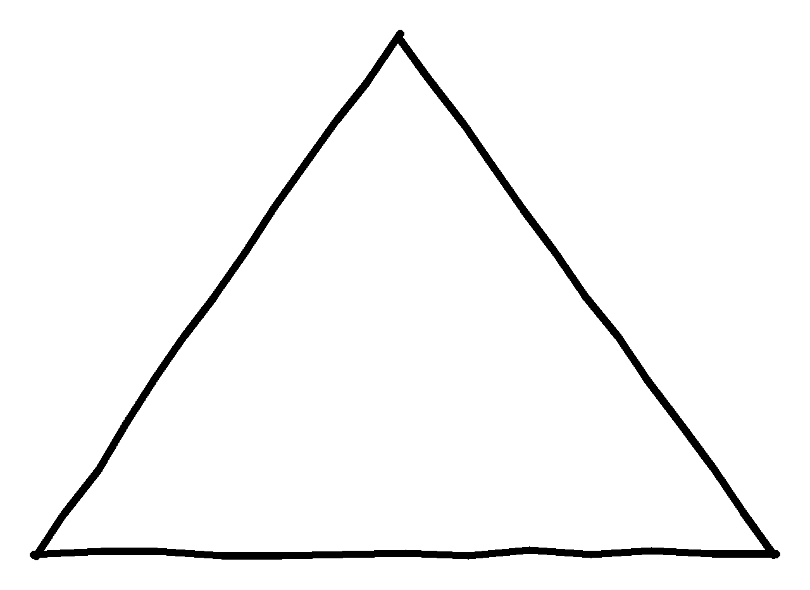

**Question:** What did I draw?

| | Liza | Whiteboard |
|---|---|---|
| Read | a triangle  | A triangle  |
| Buttons | Measure it (measure: Triangle) Explore it (explore: Triangle) | Measure it (measure: Triangle) Explore it (explore: Triangle) |
| Measured | {'angles': [[71, 55, 54]], 'faces': 1} | {'angles': [[71, 55, 54]], 'faces': 1} |
| Said | That's a triangle! It's a polygon, which means it's a closed shape made of three straight lines. A triangle always has three sides and three angles. | You've drawn a triangle! It's a shape with three straight sides and three angles. A cool fact about any triangle is that if you add up all three of its angles, they will always total 180 degrees. Tap below if you'd like to see a neat one. |
| Shown | offer_visual:geometry / Triangle | buttons: See the shape |

## two-triangles

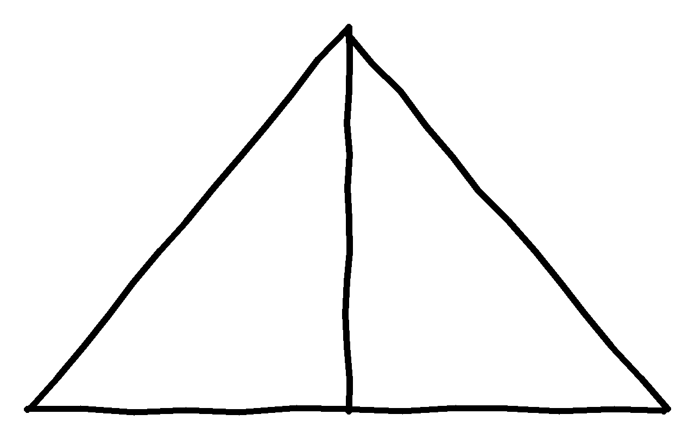

**Question:** What did I draw?

| | Liza | Whiteboard |
|---|---|---|
| Read | A triangle divided into two smaller triangles by a line from the top vertex to the base  | A triangle divided into two smaller triangles by a line from the top vertex to the base  |
| Buttons | Measure it (measure: Triangle) Explore it (explore: Triangle) | Measure it (measure: Triangle) Explore it (explore: Triangle) |
| Measured | {'angles': [[40, 50, 90], [40, 90, 50]], 'faces': 2} | {'angles': [[40, 51, 89], [40, 90, 50]], 'faces': 2} |
| Said | You've drawn a triangle, and then split it into two smaller triangles with a line from the top corner to the base. It's a great way to show how a larger shape can be made of smaller ones. Would you like to see a neat one you can explore? | It looks like you've drawn a large triangle, and then split it down the middle into two smaller triangles. Tap below if you'd like to see a neat triangle shape. |
| Shown | offer_visual:geometry / Triangle | buttons: See the shape |

## forces

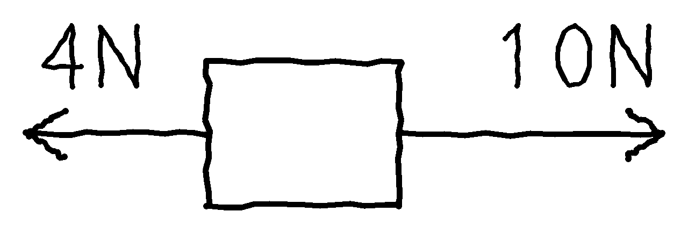

**Question:** What's the net force?

| | Liza | Whiteboard |
|---|---|---|
| Read | a block with two opposing forces: 4N to the left and 10N to the right  | a block with two arrows: 4N to the left, 10N to the right  |
| Buttons | Solve it (ask: solve) See the shape (shape: Square) | Solve it (ask: solve) See the shape (shape: Square) |
| Measured | – | – |
| Said | The net force is the total force acting on an object when you combine all the individual forces. Since these forces are in opposite directions, we subtract the smaller force from the larger one. So, we take 4 N from 10 N, which leaves 6 N. The net force is 6 N, acting to the right, because that's the direction of the larger force. | The net force is the overall force acting on an object when you combine all the individual forces. In your drawing, you have two forces acting in opposite directions. To find the net force, we subtract the smaller force from the larger one. So, you take 4 Newtons from 10 Newtons, which leaves 6 Newtons. Since the 10 Newton force is pulling to the right, the net force is 6 Newtons to the right. |
| Shown | show_visual:solution / Calculate the net force; Net force = Larger force - Smaller force :: definition of net force for opposite directions; Net force = 10\ \mathrm{N} - 4\ \mathrm{N} :: subtract the  | steps column (5 rows), see: See the forces buttons: See the forces |

## check-working

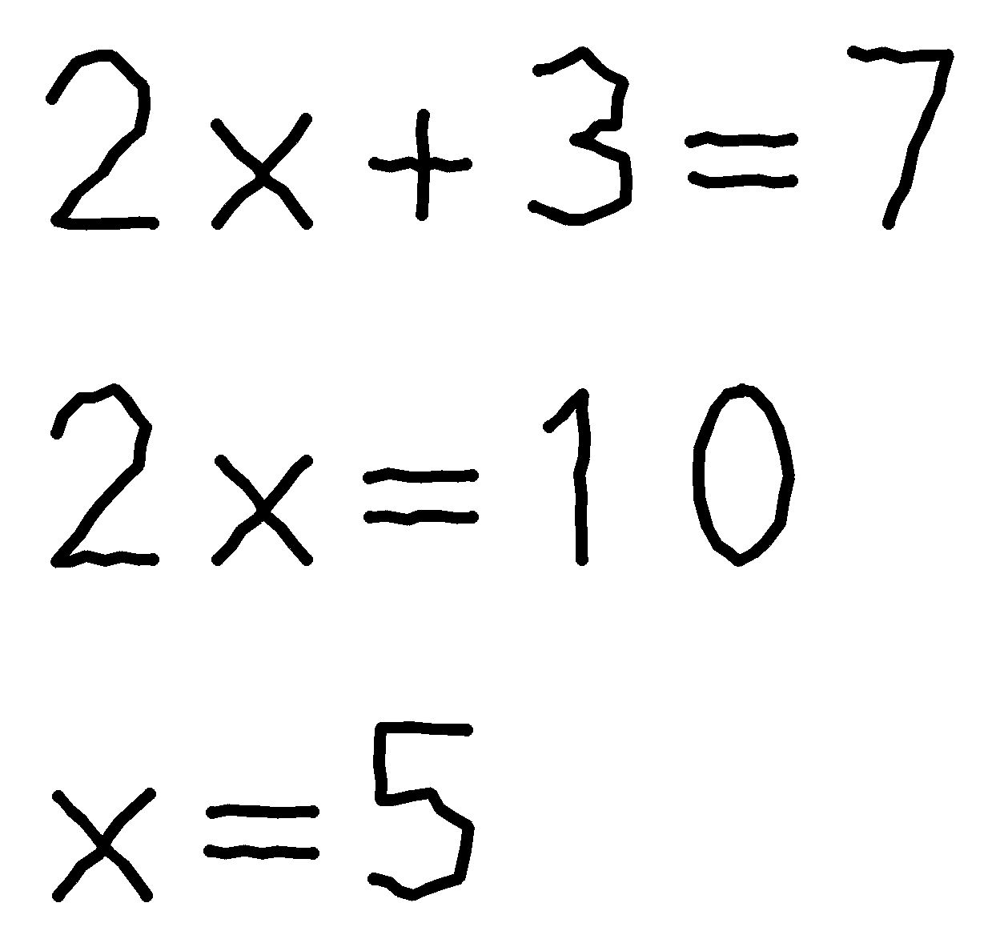

**Question:** Is my answer right?

| | Liza | Whiteboard |
|---|---|---|
| Read | 2x + 3 = 7 ; 2x = 10 ; x = 5  | 2x + 3 = 7 ; 2x = 10 ; x = 5  |
| Buttons | Solve it (ask: solve) Plot it (graph: 2x + 3 = 7) | Solve it (ask: solve) Plot it (graph: 2x + 3 = 7) |
| Measured | – | – |
| Said | You've done a great job with the last step, but there's a small change needed in the second line. When you move the 3 to the other side, you need to subtract it from 7, not add it. So, 7 minus 3 is 4, which means 2x should be 4. Then, divide both sides by 2 to find x. | You're really close! The first line is perfect. But when you move the 3 to the other side, you need to subtract it from the 7, not add it. So, 7 minus 3 would be 4, not 10. Let me show you the steps. |
| Shown | show_visual:solution / Solve 2x + 3 = 7; 2x + 3 = 7 :: the equation; 2x = 7 - 3 = 4 :: take 3 from both sides; x = \frac{4}{2} = 2 :: divide both sides by 2; answer = x = 2; see = graph: y = 2x + 3 | steps column (4 rows), see: See the graph buttons: See the graph |

## house

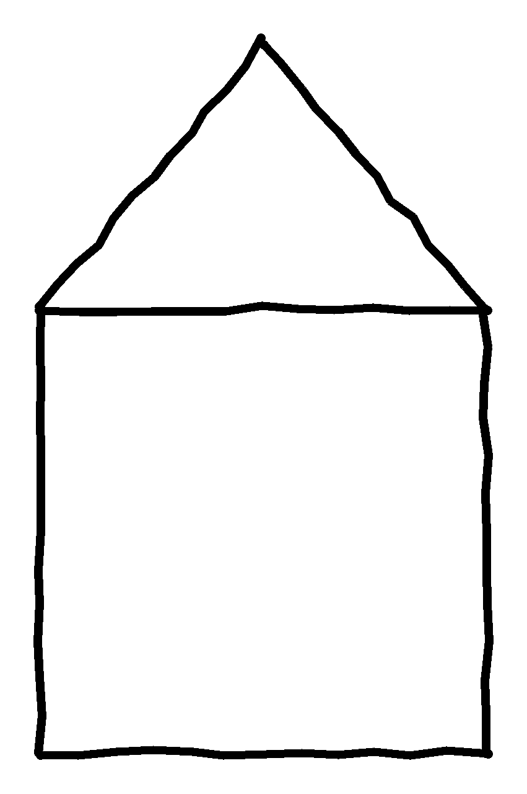

**Question:** What did I draw?

| | Liza | Whiteboard |
|---|---|---|
| Read | a house  | a house  |
| Buttons | Measure it (measure: House: a square with a triangle on top) Explore it (explore: House: a square with a triangle on top) | Measure it (measure: House: a square with a triangle on top) Explore it (explore: House: a square with a triangle on top) |
| Measured | {'angles': [[80, 50, 50], [90, 90, 90, 90]], 'faces': 2} | {'angles': [[80, 50, 50], [90, 90, 90, 90]], 'faces': 2} |
| Said | That looks like a house! It's made up of a square or rectangle at the bottom and a triangle for the roof. | That looks like a house! It's made up of a square or rectangle at the bottom and a triangle on top for the roof. |
| Shown | – | buttons: See a picture |

## circle-area

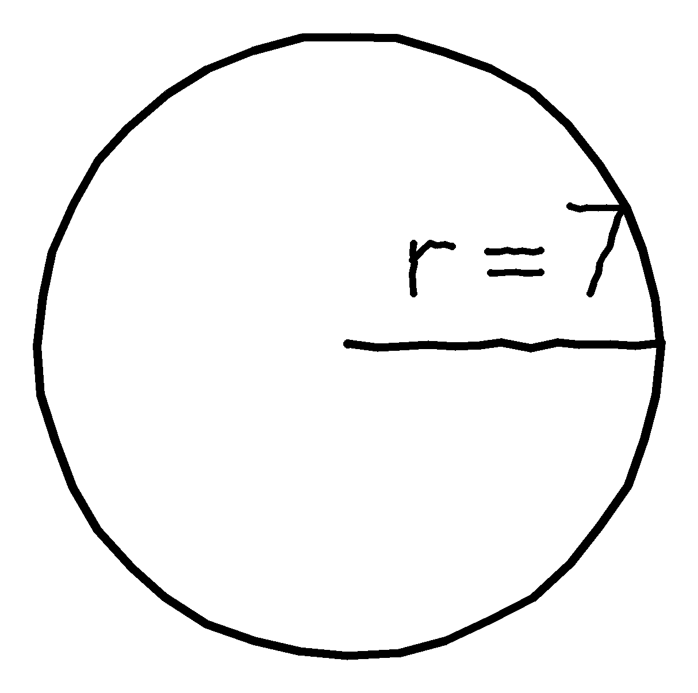

**Question:** Find the area

| | Liza | Whiteboard |
|---|---|---|
| Read | r = 7  | a circle with radius r = 7  |
| Buttons | Solve it (ask: solve) See the shape (shape: Circle; radius = 7) | Solve it (ask: solve) See the shape (shape: Circle; radius = 7) |
| Measured | – | – |
| Said | Okay, to find the area of your circle, we use the formula A = πr², where 'A' stands for area and 'r' is the radius. You've given the radius as 7. So, we square the radius, which is 7 times 7, giving us 49. Then we multiply that by pi. | Okay, to find the area of a circle, we use the formula Area equals pi r squared. We'll substitute the radius, which you've given as 7, into the formula, using 22/7 for pi. First, calculate 7 squared, which is 49. Then, we can simplify by dividing 49 by 7, leaving us with 22 times 7. That gives us an area of 154 square units. |
| Shown | show_visual:solution / Find the area of the circle; A = \pi r^2 :: The formula for the area of a circle; A = \pi (7)^2 :: Substitute the radius, r = 7; A = 49\pi\ \mathrm{units}^2 :: Calculate 7 squar | steps column (6 rows), see: See the shape buttons: See the shape |

## pendulum

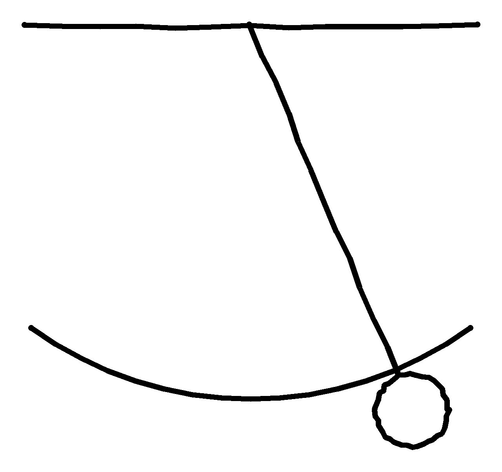

**Question:** What did I draw?

| | Liza | Whiteboard |
|---|---|---|
| Read | a pendulum with a bob and its path  | a pendulum with a bob at the end of its swing  |
| Buttons | Run the simulation (model3d: pendulum) | See the shape (shape: Circle) Run the simulation (model3d: pendulum) |
| Measured | – | – |
| Said | That looks like a pendulum! It's a weight, called a bob, hanging from a pivot so it can swing freely. When you pull it to one side and let it go, it swings back and forth due to gravity. This back and forth movement is called oscillation. Tap below to see a simulation of it. | You've drawn a pendulum! That's a weight, often called a bob, hanging from a point so it can swing freely. When you pull it to one side and let it go, it swings back and forth because of gravity. This regular back-and-forth movement is called oscillation. Tap below to see a simulation of one. |
| Shown | offer_visual:model3d / pendulum | buttons: Run the simulation |

## trig

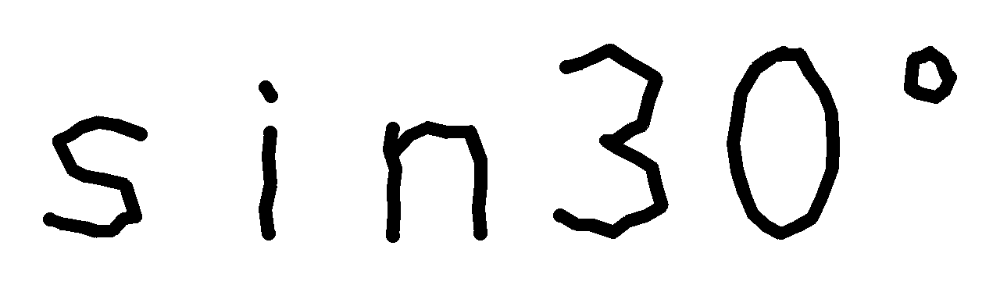

**Question:** What is the value?

| | Liza | Whiteboard |
|---|---|---|
| Read | sin 30°  | sin 30°  |
| Buttons | Solve it (ask: solve) | Solve it (ask: solve) |
| Measured | – | – |
| Said | The value of sin 30° is one half, or 0.5. | The value of sine thirty degrees is one half. |
| Shown | show_visual:solution / Value of sin 30°; \sin 30^\circ = \frac{1}{2} :: This is a standard trigonometric value; answer = \frac{1}{2} | steps column (2 rows), see: See the shape buttons: See the shape |

## hindi-solve

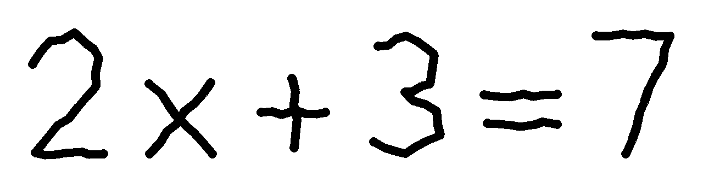

**Question:** इसे हल करो

| | Liza | Whiteboard |
|---|---|---|
| Read | 2x + 3 = 7  | 2x + 3 = 7  |
| Buttons | हल करो (ask: solve) ग्राफ़ बनाओ (graph: 2x + 3 = 7) | हल करो (ask: solve) ग्राफ़ बनाओ (graph: 2x + 3 = 7) |
| Measured | – | – |
| Said | ठीक है, इसे हल करते हैं। पहले दोनों तरफ से 3 घटाएंगे, तो 2x बराबर 4 बचेगा। फिर दोनों तरफ को 2 से भाग देंगे। तो x का मान 2 आएगा! | पहले दोनों तरफ से 3 घटाते हैं, तो 2x बराबर 4 हो जाएगा। फिर, दोनों तरफ को 2 से भाग देते हैं। तो x बराबर 2 है। |
| Shown | show_visual:solution / Solve 2x + 3 = 7; 2x + 3 = 7 :: समीकरण; 2x = 7 - 3 = 4 :: दोनों तरफ से 3 घटाओ; x = \frac{4}{2} = 2 :: दोनों तरफ को 2 से भाग दो; answer = x = 2; see = graph: y = 2x + 3 | steps column (4 rows), see: ग्राफ़ देखो buttons: ग्राफ़ देखो |

## integral

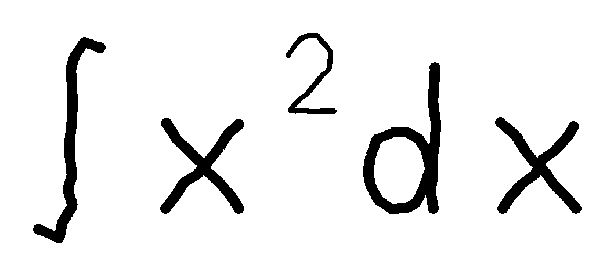

**Question:** Solve this

| | Liza | Whiteboard |
|---|---|---|
| Read | ∫ x² dx  | ∫ x² dx  |
| Buttons | Solve it (ask: solve) | Solve it (ask: solve) |
| Measured | – | – |
| Said | To solve this integral, we use the power rule for integration. You add 1 to the power of x, and then divide by the new power. So, x squared becomes x to the power of three, divided by three, plus a constant. | Okay, I can help you solve that integral. First, we use the power rule for integration, which means we add one to the exponent and then divide by that new exponent. So, for x^2, the exponent becomes 2+1, which is 3. Then we divide by 3. Don't forget to add the constant of integration, C, because it's an indefinite integral. |
| Shown | show_visual:solution / Solve $\int x^2 dx$; $\int x^n dx = \frac{x^{n+1}}{n+1} + C$ :: the power rule for integration; $\int x^2 dx = \frac{x^{2+1}}{2+1} + C$ :: apply the rule; $\int x^2 dx = \frac{x | steps column (4 rows) |
